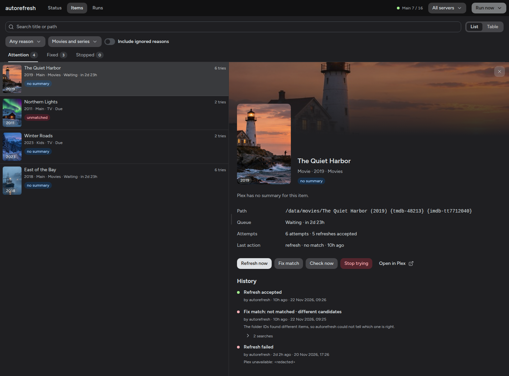
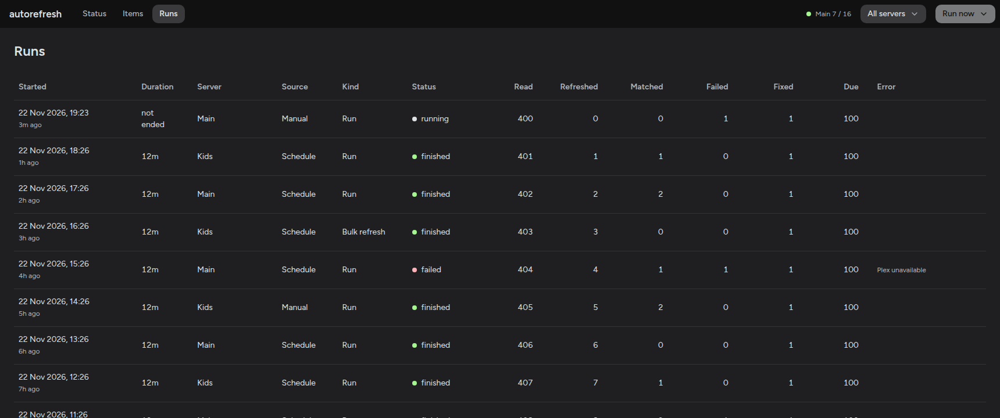
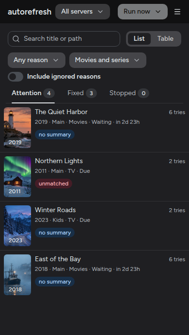

# autorefresh

Autorefresh finds Plex movies and shows with missing metadata and asks Plex to refresh them on a schedule. It runs beside [autoscan](https://github.com/l3uddz/autoscan) and includes an optional web dashboard.

The project is in early development.

## Features

Autorefresh monitors Plex movie libraries (`tv.plex.agents.movie`) and show libraries (`tv.plex.agents.series`) across one or more servers:

- Detects movies and shows that are unmatched or missing a summary, poster, or background art. For matched shows, it also detects unmatched regular episodes and regular episodes without a summary. Specials in season 0 do not count.
- Refreshes one item at a time. It never triggers a library-wide "Refresh All Metadata".
- Waits `minimum-age` before touching new items, paces requests with `refresh-delay`, and backs off retries on items that stay incomplete.
- Flags a matched movie whose folder or file names IDs, such as `{tmdb-747059}`, that disagree with Plex (reason `mismatched`). At least one source (TMDB, IMDb, or TVDB) must be named by the paths and listed by Plex, and no such source may agree, so a shared IMDb ID outweighs a differing TMDB ID. The reason alone never makes a movie due, so a run never refreshes or re-matches a movie because of it. Another missing reason, such as a missing summary, is still refreshed as usual. A movie whose only reason is `mismatched` waits in Attention as "Needs a manual fix" until you fix the match. Refresh now in the dashboard runs the automatic fix match of a mismatched movie and applies its pick when the pick differs from the current match. The next full read finds the movies of an older cache.
- Fixes unmatched items automatically when folder or file names include a matching ID, such as `{tmdb-747059}`, `[imdb-tt19120100]`, or `(tvdb-463649)`. Setting `tmdb-token` adds TMDB lookups for IMDb and TVDB IDs, release year and episode confirmation, and title fallback for shows.
- Serves an optional web dashboard to watch runs live, browse incomplete and fixed items, run bulk actions, and fix matches by hand.

## Dashboard



Screenshots show the running dashboard with sample library data and generated artwork.

<details>
<summary>More dashboard screenshots</summary>

Status shows server health, live progress, recently fixed items, and recent runs.


Fix match shows candidate posters, Plex scores, and evidence from the last automatic match attempt.


Runs shows run history and results across servers.



Items on a phone keeps the tabs, filters, and posters in a single column.



</details>

The dashboard has three pages:

- Status: server health, live run progress, and manual runs.
- Items: Attention, Fixed, and Stopped queues with search, filters, bulk actions, and manual Fix Match.
- Runs: run history and per-item outcomes.

A wrong movie match has a pink `mismatched` reason badge, and the reason filter of Items can show only these movies. A movie whose only counted reason is `mismatched` has the queue state "Needs a manual fix"; with another reason, such as `no-art`, it keeps the usual state, such as "Due". Its item detail shows a warning with the path ID and the Plex IDs of each source that disagrees. Use Fix match there to choose the right match, or Refresh now to apply the automatic pick. Refresh now matches the movie only when the folder ID searches pick a candidate that is not the current match, and only while Plex still shows the same wrong match just before the match. When the pick is the current match, for example because a file name holds an outdated ID, Refresh now sends only a refresh, and you fix the ID in the path.

In the Items and Runs tables, a hand cursor shows where you can click to open details.
Clicking anywhere on the non-interactive surface of a linked list row opens its item or run details.
Action toasts (including errors) close automatically after 5 seconds by default (10 seconds for bulk refresh end reports), pausing while hovered or focused.

To enable the dashboard, add a `ui` section to `config.yml`:

```yaml
ui:
  listen: ":7380"          # in Docker keep ":7380", on a bare host use "127.0.0.1:7380" behind a local reverse proxy
  username: admin          # optional, set both username and password for HTTP Basic auth
  password: change-me
```

The dashboard stays off when `--once` or `--dry-run` is set.

Without `username` and `password`, the dashboard has no authentication. Allow access only from a trusted network or an authenticating reverse proxy. If traffic leaves a trusted network, put a reverse proxy with HTTPS in front of it. If a reverse proxy connects over plain HTTP, pass the original `Host` header. If you serve the dashboard at a sub-path such as `/autorefresh/`, redirect `/autorefresh` to `/autorefresh/` so relative links work.

## Docker

CI publishes `l3uddz/autorefresh` to Docker Hub for `linux/amd64`, `linux/arm64`, and `linux/arm/v7`. Use `latest` or `<version>` for releases, or `main` for the latest commit on `main`.

Mount a directory at `/config` to store `config.yml`, `autorefresh.db`, and `activity.log`. The container runs as non-root user `65532:65532` by default. Set `--user` (or `user:` in Compose) to match the owner of `/config`, and set `TZ` for the schedule time zone. When you enable the dashboard in Docker, set `ui.listen: ":7380"` and publish port `7380` (use `127.0.0.1:7380:7380` to limit it to a reverse proxy on the same host).

Docker Compose:

```yaml
services:
  autorefresh:
    image: l3uddz/autorefresh:main
    container_name: autorefresh
    restart: unless-stopped
    user: 1000:1000
    environment:
      - TZ=Europe/London
    ports:
      - 7380:7380  # remove if ui.listen is not set
    volumes:
      - /opt/autorefresh:/config
```

Docker CLI:

```sh
docker run -d --name autorefresh \
  --user 1000:1000 \
  -e TZ=Europe/London \
  -p 7380:7380 \
  -v /opt/autorefresh:/config \
  l3uddz/autorefresh:main
```

## Configuration

Place `config.yml` in `/config` (Docker), next to the binary, or in `~/.config/autorefresh` on Linux. If the file is missing or empty at startup, autorefresh waits until it appears.

```yaml
schedule: "0 * * * *"
minimum-age: 24h
refresh-interval: 24h
max-refresh-interval: 168h
cache-refresh: "0 3 * * 0"
oversample: 48h
refresh-delay: 5s
max-refreshes-per-run: 100
ignore-reasons: []
tmdb-token: ""
history-retention: 720h

ui:
  listen: ""                  # set to ":7380" to enable the dashboard
  username: ""
  password: ""

plex:
  - name: main
    url: https://plex.example.com
    token: XXXX
    timeout: 30s
    libraries:
      - Movies
      - TV
```

Only `plex` is required. Every other key is optional and falls back to its default.

| Key | Default | Description |
| --- | --- | --- |
| `schedule` | `0 * * * *` | Cron expression for scheduled runs (uses local time or `TZ`) |
| `minimum-age` | `24h` | Skip items added less than this long ago |
| `refresh-interval` | `24h` | Initial wait between refresh attempts on one item |
| `max-refresh-interval` | `168h` | Longest wait after exponential backoff (24h, 24h, 48h, 96h, then 168h with defaults) |
| `cache-refresh` | `0 3 * * 0` | Cron expression for full library reads (runs on the first `schedule` run at or after this time) |
| `oversample` | `48h` | Extra lookback window for incremental library reads |
| `refresh-delay` | `5s` | Delay between items on the same server |
| `max-refreshes-per-run` | `100` | Maximum items handled per server per run (`0` for no limit) |
| `ignore-reasons` | `[]` | Reasons that never trigger a refresh (listed below) |
| `tmdb-token` | `""` | Optional TMDB API Read Access Token (not the short API key) for Fix Match fallbacks |
| `history-retention` | `720h` | How long dashboard item and run history is kept |
| `ui.listen` | `""` | Dashboard address as `host:port` (empty disables the dashboard) |
| `ui.username` | `""` | Optional HTTP Basic auth username (set together with `ui.password`) |
| `ui.password` | `""` | Optional HTTP Basic auth password (set together with `ui.username`) |

Each entry under `plex` configures one Plex server:

| Key | Required | Default | Description |
| --- | --- | --- | --- |
| `name` | yes | none | Unique server label. Renaming it removes the old cache and history on the next run |
| `url` | yes | none | `http` or `https` server URL (path allowed, no userinfo, query, or fragment) |
| `token` | yes | none | Plex server token (use `https` outside a trusted network) |
| `libraries` | no | all supported | Optional list of library titles to include |
| `timeout` | no | `30s` | Timeout for each request to this server |

Valid values for `ignore-reasons`: `unmatched`, `no-summary`, `no-poster`, `no-art`, `episode-no-summary`, `episode-unmatched`, and `mismatched`.

Durations use Go units such as `s`, `m`, and `h` (write 7 days as `168h`). Unknown keys fail validation.

## Command line

| Flag | Environment variable | Default | Description |
| --- | --- | --- | --- |
| `--config` | `AUTOREFRESH_CONFIG` | `config.yml` | Configuration file path |
| `--database` | `AUTOREFRESH_DATABASE` | `autorefresh.db` | SQLite database file path |
| `--log` | `AUTOREFRESH_LOG` | `activity.log` | Rotated log file path (5 MB, 5 backups, 14 days) |
| `-v`, `--verbosity` | `AUTOREFRESH_VERBOSITY` | `0` | Log level: `0` info, `1` debug, `2` or more trace |
| `--dry-run` | `AUTOREFRESH_DRY_RUN` | off | Read Plex, update the cache, and log planned actions without sending refresh or match requests |
| `--once` | `AUTOREFRESH_ONCE` | off | Run one check and exit |
| `--version` | none | none | Print version information and exit |

Default file paths resolve to the binary directory if `config.yml` is next to it, or to `~/.config/autorefresh` on Linux. In Docker, the image points them to `/config`. Logs are written to stderr and the log file, and tokens and server URLs are never logged. The SQLite database (`autorefresh.db`) uses WAL mode, so keep it on local POSIX storage rather than NFSv3 or SMB mounts. Outside a dry run, after a scheduled run, a Run now scan, or a `--once` run, autorefresh tries to give free space back to the file system when at least a fifth of the database and at least 1 MiB are free, such as after a removed server or library or a shorter `history-retention`. This needs SQLite's incremental auto-vacuum mode. A new database starts in that mode, and a start that is not a `--dry-run` converts an older database of at most 256 MiB (its page count times its page size) to it; autorefresh does not release the free pages of a database in another mode. Another process that reads the database at the same time can delay giving the space back. The conversion needs the file to itself, so while another autorefresh process, such as a `--once` run, has it open, it waits for a later start.

To test your configuration without changing anything in Plex:

```sh
autorefresh --once --dry-run
```

A dry run still updates the database cache without recording history. If it sees a cached item that is now complete or gone from Plex, it removes that item from the cache. A later normal run then records no fixed or removed event for it.

## Requests and library reads

Before each refresh or match request, autorefresh saves a write attempt in the database. This costs one database write for each request. The attempt protects its item for `timeout` plus 10 minutes after it starts, because Plex can apply a request after it answers.

- While an attempt is live, the dashboard shows its item as `waiting`, and no run sends the item an automatic request. This also applies when the answer was lost, or was a 3xx, 408, 429, or 5xx answer, because Plex can still have taken the request. A request that Plex rejects (400, 401, 403, 404, or 405) ends the protection at once.
- A library read leaves an item unchanged when an attempt for it was live during the read, and saves a hold for the item. The next read of a library with a hold is a full read. It applies the item, deletes the hold, and costs one full listing of the library. A held item stays `waiting` and gets no automatic request until then. The dashboard shows it as "Waiting · next run" when its usual wait has passed. If your `schedule` starts runs more often than every `timeout` plus 10 minutes, a library with recent requests can get a full read on every run.
- A held item that the full listing omits while Plex still has it keeps its hold, and autorefresh logs `Held item not in listing`. Its library then gets a full read on every run.
- After a match, the checks wait until Plex shows the GUID of the chosen candidate. If Plex does not show it before the checks end, the row stays as it was and the item gets a hold.
- A check after a request saves nothing, and the item gets a hold, when another request can still change the item. For example, Refresh now within `timeout` plus 10 minutes after an accepted match reports the reasons as not current, and the item stays `waiting` until the next run. Refresh now and then Fix match still moves a fixed item to Fixed at once.
- A refresh or match request does not follow a redirect. If a proxy in front of Plex redirects these requests, they fail.
- An item action whose save or request runs past the server `timeout` answers 504 `timed out` instead of 502.
- A run sends no request to the items of a library whose read failed in that run. Before, it still refreshed the cached items of that library.
- When another autorefresh process prunes the history, the attempts, or the cache of a library during a read, autorefresh does not apply the read. A full scan then fails. Another run logs `Read is older than pruning` and reads the library again in the next run.
- A dry run saves and deletes holds, because they are cache state.
- Two processes that read the same library at the same time, such as a `--once` run beside the service, are not protected against each other.

Other new log lines: `Skipped follow-up refresh` means that a run did not send the refresh after its match because another request or a hold holds the item. `Dropping write attempt failed` means that the attempt of a request that was not sent stays until its end.

### Upgrade and rollback

The upgrade adds database tables for the write attempts and the holds. Before you upgrade, stop every autorefresh process that uses the database, also a `--once` run from cron. An older version refuses to open the upgraded database.

To go back to an older version, stop every autorefresh process, and then run this SQL on the database, for example with `sqlite3 autorefresh.db`:

```sql
BEGIN IMMEDIATE;
DROP TABLE read_hold;
DROP TABLE write_attempt;
DROP TABLE prune_fence;
DELETE FROM schema_migration WHERE version = 18;
COMMIT;
```

## Build from source

Install [mise](https://mise.jdx.dev), then build the binary with the embedded dashboard:

```sh
mise install
mise run build
```

The binary is written to `dist/autorefresh_<os>_<arch>/`. A plain `go build ./cmd/autorefresh` needs no Node.js and builds without the embedded dashboard UI.

## License

[MIT](LICENSE)
