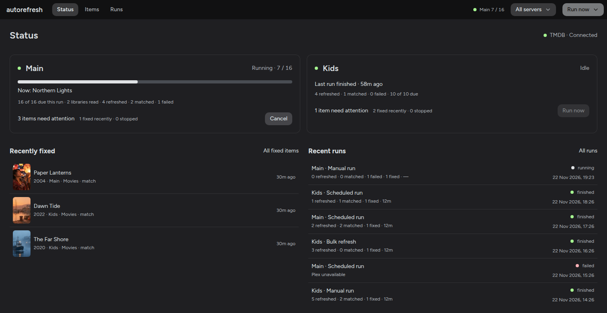
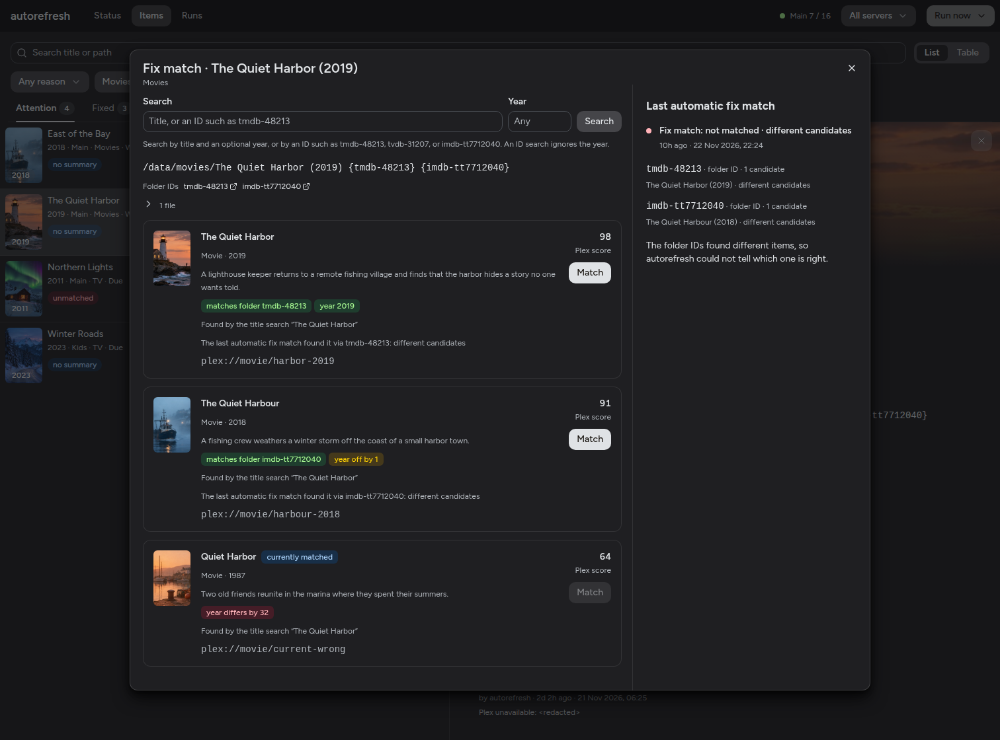

# autorefresh

Autorefresh finds Plex movies and shows with missing metadata and asks Plex to refresh them on a schedule. It runs beside [autoscan](https://github.com/l3uddz/autoscan) and includes an optional web dashboard.

The project is in early development.

## Features

Autorefresh monitors Plex movie libraries (`tv.plex.agents.movie`) and show libraries (`tv.plex.agents.series`) across one or more servers:

- Detects movies and shows that are unmatched or missing a summary, poster, or background art. For matched shows, it also detects unmatched regular episodes and regular episodes without a summary. Specials in season 0 do not count.
- Refreshes one item at a time. It never triggers a library-wide "Refresh All Metadata".
- Waits `minimum-age` before touching new items, paces requests with `refresh-delay`, and backs off retries on items that stay incomplete.
- Fixes unmatched items automatically when folder or file names include a matching ID, such as `{tmdb-747059}`, `[imdb-tt19120100]`, or `(tvdb-463649)`. Setting `tmdb-token` adds TMDB lookups for IMDb and TVDB IDs, release year and episode confirmation, and title fallback for shows.
- Serves an optional web dashboard to watch runs live, browse incomplete and fixed items, run bulk actions, and fix matches by hand.

## Dashboard


Screenshots show the running dashboard with sample library data and generated artwork.

<details>
<summary>More dashboard screenshots</summary>

Status shows server health, live progress, recently fixed items, and recent runs.



Fix match shows candidate posters, Plex scores, and evidence from the last automatic match attempt.



Runs shows run history and results across servers.


Items on a phone keeps the tabs, filters, and posters in a single column.


</details>

The dashboard has three pages:

- Status: server health, live run progress, and manual runs.
- Items: Attention, Fixed, and Stopped queues with search, filters, bulk actions, and manual Fix Match.
- Runs: run history and per-item outcomes.

In the Items and Runs tables, a hand cursor shows where you can click to open details.
Clicking anywhere on the non-interactive surface of a linked list row opens its item or run details.
Action toasts (including errors) close automatically after 5 seconds by default (10 seconds for bulk refresh end reports), pausing while hovered or focused.

To enable the dashboard, add a `ui` section to `config.yml`:

```yaml
ui:
  listen: ":7380"          # in Docker keep ":7380", on a bare host use "127.0.0.1:7380" behind a local reverse proxy
  username: admin          # optional, set both username and password for HTTP Basic auth
  password: change-me
```

The dashboard stays off when `--once` or `--dry-run` is set.

Without `username` and `password`, the dashboard has no authentication. Allow access only from a trusted network or an authenticating reverse proxy. If traffic leaves a trusted network, put a reverse proxy with HTTPS in front of it. If a reverse proxy connects over plain HTTP, pass the original `Host` header. If you serve the dashboard at a sub-path such as `/autorefresh/`, redirect `/autorefresh` to `/autorefresh/` so relative links work.

## Docker

CI publishes `l3uddz/autorefresh` to Docker Hub for `linux/amd64`, `linux/arm64`, and `linux/arm/v7`. Use `latest` or `<version>` for releases, or `main` for the latest commit on `main`.

Mount a directory at `/config` to store `config.yml`, `autorefresh.db`, and `activity.log`. The container runs as non-root user `65532:65532` by default. Set `--user` (or `user:` in Compose) to match the owner of `/config`, and set `TZ` for the schedule time zone. When you enable the dashboard in Docker, set `ui.listen: ":7380"` and publish port `7380` (use `127.0.0.1:7380:7380` to limit it to a reverse proxy on the same host).

Docker Compose:

```yaml
services:
  autorefresh:
    image: l3uddz/autorefresh:main
    container_name: autorefresh
    restart: unless-stopped
    user: 1000:1000
    environment:
      - TZ=Europe/London
    ports:
      - 7380:7380  # remove if ui.listen is not set
    volumes:
      - /opt/autorefresh:/config
```

Docker CLI:

```sh
docker run -d --name autorefresh \
  --user 1000:1000 \
  -e TZ=Europe/London \
  -p 7380:7380 \
  -v /opt/autorefresh:/config \
  l3uddz/autorefresh:main
```

## Configuration

Place `config.yml` in `/config` (Docker), next to the binary, or in `~/.config/autorefresh` on Linux. If the file is missing or empty at startup, autorefresh waits until it appears.

```yaml
schedule: "0 * * * *"
minimum-age: 24h
refresh-interval: 24h
max-refresh-interval: 168h
cache-refresh: "0 3 * * 0"
oversample: 48h
refresh-delay: 5s
max-refreshes-per-run: 100
ignore-reasons: []
tmdb-token: ""
history-retention: 720h

ui:
  listen: ""                  # set to ":7380" to enable the dashboard
  username: ""
  password: ""

plex:
  - name: main
    url: https://plex.example.com
    token: XXXX
    timeout: 30s
    libraries:
      - Movies
      - TV
```

Only `plex` is required. Every other key is optional and falls back to its default.

| Key | Default | Description |
| --- | --- | --- |
| `schedule` | `0 * * * *` | Cron expression for scheduled runs (uses local time or `TZ`) |
| `minimum-age` | `24h` | Skip items added less than this long ago |
| `refresh-interval` | `24h` | Initial wait between refresh attempts on one item |
| `max-refresh-interval` | `168h` | Longest wait after exponential backoff (24h, 24h, 48h, 96h, then 168h with defaults) |
| `cache-refresh` | `0 3 * * 0` | Cron expression for full library reads (runs on the first `schedule` run at or after this time) |
| `oversample` | `48h` | Extra lookback window for incremental library reads |
| `refresh-delay` | `5s` | Delay between items on the same server |
| `max-refreshes-per-run` | `100` | Maximum items handled per server per run (`0` for no limit) |
| `ignore-reasons` | `[]` | Reasons that never trigger a refresh (listed below) |
| `tmdb-token` | `""` | Optional TMDB API Read Access Token (not the short API key) for Fix Match fallbacks |
| `history-retention` | `720h` | How long dashboard item and run history is kept |
| `ui.listen` | `""` | Dashboard address as `host:port` (empty disables the dashboard) |
| `ui.username` | `""` | Optional HTTP Basic auth username (set together with `ui.password`) |
| `ui.password` | `""` | Optional HTTP Basic auth password (set together with `ui.username`) |

Each entry under `plex` configures one Plex server:

| Key | Required | Default | Description |
| --- | --- | --- | --- |
| `name` | yes | none | Unique server label. Renaming it removes the old cache and history on the next run |
| `url` | yes | none | `http` or `https` server URL (path allowed, no userinfo, query, or fragment) |
| `token` | yes | none | Plex server token (use `https` outside a trusted network) |
| `libraries` | no | all supported | Optional list of library titles to include |
| `timeout` | no | `30s` | Timeout for each request to this server |

Valid values for `ignore-reasons`: `unmatched`, `no-summary`, `no-poster`, `no-art`, `episode-no-summary`, and `episode-unmatched`.

Durations use Go units such as `s`, `m`, and `h` (write 7 days as `168h`). Unknown keys fail validation.

## Command line

| Flag | Environment variable | Default | Description |
| --- | --- | --- | --- |
| `--config` | `AUTOREFRESH_CONFIG` | `config.yml` | Configuration file path |
| `--database` | `AUTOREFRESH_DATABASE` | `autorefresh.db` | SQLite database file path |
| `--log` | `AUTOREFRESH_LOG` | `activity.log` | Rotated log file path (5 MB, 5 backups, 14 days) |
| `-v`, `--verbosity` | `AUTOREFRESH_VERBOSITY` | `0` | Log level: `0` info, `1` debug, `2` or more trace |
| `--dry-run` | `AUTOREFRESH_DRY_RUN` | off | Read Plex, update the cache, and log planned actions without sending refresh or match requests |
| `--once` | `AUTOREFRESH_ONCE` | off | Run one check and exit |
| `--version` | none | none | Print version information and exit |

Default file paths resolve to the binary directory if `config.yml` is next to it, or to `~/.config/autorefresh` on Linux. In Docker, the image points them to `/config`. Logs are written to stderr and the log file, and tokens and server URLs are never logged. The SQLite database (`autorefresh.db`) uses WAL mode, so keep it on local POSIX storage rather than NFSv3 or SMB mounts.

To test your configuration without changing anything in Plex:

```sh
autorefresh --once --dry-run
```

A dry run still updates the database cache without recording history. If it sees a cached item that is now complete or gone from Plex, it removes that item from the cache. A later normal run then records no fixed or removed event for it.

## Build from source

Install [mise](https://mise.jdx.dev), then build the binary with the embedded dashboard:

```sh
mise install
mise run build
```

The binary is written to `dist/autorefresh_<os>_<arch>/`. A plain `go build ./cmd/autorefresh` needs no Node.js and builds without the embedded dashboard UI.

## License

[MIT](LICENSE)
